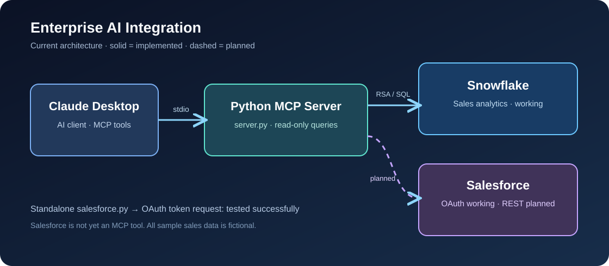
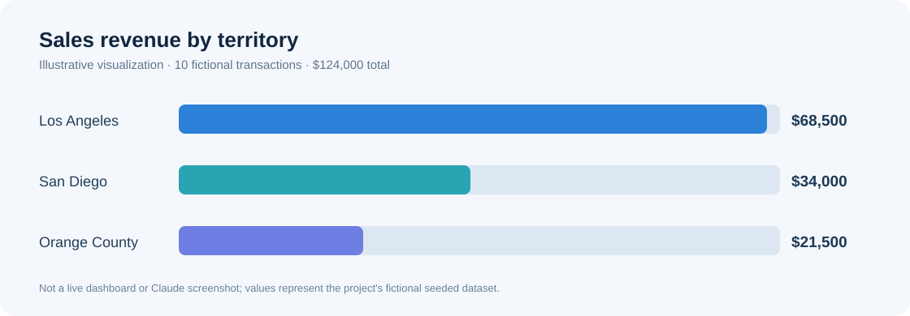

<div align="center">

# Enterprise AI Integration
### Secure AI-assisted sales analytics across Snowflake and Salesforce

**Python · Model Context Protocol · Claude Desktop · Snowflake · Salesforce · OAuth 2.0**



**Working:** Snowflake analytics via Claude MCP · Salesforce OAuth authentication  
**In development:** Salesforce record retrieval · Combined CRM and warehouse insights

[Overview](#overview) · [Architecture](#architecture) · [Quick start](#quick-start) · [Documentation](#documentation) · [Roadmap](#roadmap)

</div>

---

## Overview

A portfolio project exploring how an AI assistant can securely interact with enterprise business systems through a **Python Model Context Protocol (MCP) server**. It currently exposes **two read-only Snowflake analytics tools** to Claude Desktop and includes a **separately tested Salesforce OAuth 2.0 client-credentials integration**.

**Business scenario:** A sales leader wants to ask questions in natural language about revenue by territory or representative. The MCP server executes constrained, predefined SQL queries and returns structured data. Future work will add Salesforce CRM records and cross-platform analysis.

> **Demo scope:** All sample company and transaction data is fictional. This is a learning/portfolio implementation, not a production deployment. Salesforce data retrieval is **not** yet connected to the MCP server.

## At a glance

| Capability | Implementation | Status |
| --- | --- | --- |
| Snowflake data warehouse | `ENTERPRISE_AI.SALES.SALES_TRANSACTIONS` | ✅ Configured |
| Least-privilege Snowflake access | Dedicated service user, read role, RSA key pair | ✅ Configured |
| MCP analytics tools | Revenue by territory and sales representative | ✅ Working |
| Claude Desktop | Local stdio MCP connection | ✅ Tested |
| Salesforce authentication | OAuth 2.0 client credentials, dedicated integration user | ✅ Tested |
| Salesforce Account REST query | SOQL and JSON response handling | 🔜 Next |
| Salesforce MCP tools | Account and opportunity read tools | 📋 Planned |
| Combined insights | CRM pipeline + historical sales | 📋 Planned |

## Architecture


- **Claude Desktop** invokes tools exposed by the local Python MCP server over **stdio**.
- **`server.py`** opens a Snowflake connection using an RSA private key and executes fixed read-only SQL aggregations.
- **`salesforce.py`** independently requests a Salesforce OAuth access token using the client credentials grant; the token is **not** displayed.
- **Salesforce REST querying is the next step**; the dashed path in the diagram is planned, not operational.

See [Architecture and data flow](docs/ARCHITECTURE.md).

## Example analytics



The illustration uses the **fictional seeded dataset**, not a screenshot of a live Claude session.

| Territory | Sample revenue |
| --- | ---: |
| Los Angeles | $68,500 |
| San Diego | $34,000 |
| Orange County | $21,500 |
| **Total** | **$124,000** |

## Repository layout

```text
Enterprise-AI-Integration/
├── server.py                 # Snowflake-backed MCP server (2 tools)
├── salesforce.py             # Salesforce OAuth client credentials test
├── snowflake_test.py         # Standalone Snowflake query smoke test
├── requirements.txt         # Python dependencies
├── .env.example              # Safe configuration template (no secrets)
├── .gitignore                # Excludes secrets, keys and local artifacts
├── assets/
│   ├── architecture.svg      # Architecture diagram
│   └── sales-overview.svg    # Illustrative seeded data visualization
└── docs/
    ├── ARCHITECTURE.md       # Integration design and data flow
    ├── SETUP.md              # Local setup and verification
    ├── SECURITY.md           # Credentials, permissions and safe sharing
    └── ROADMAP.md            # Verified milestones and next steps
```

## Quick start

**Requirements:** Python 3.12 (tested locally), Snowflake account, Salesforce Developer Edition (for OAuth test), and optionally Claude Desktop.

```powershell
# From the repository directory (Windows PowerShell)
py -3.12 -m venv .venv
.\.venv\Scripts\Activate.ps1
pip install -r requirements.txt
Copy-Item .env.example .env
```

Populate `.env` **locally** with your own values. Create `keys/` and place your **own** Snowflake private key at `keys/ai_mcp_service.p8`. **Never commit `.env` or the private key.** Configure the Snowflake service role, grants, and Salesforce External Client App as described in [Setup](docs/SETUP.md).

```powershell
python snowflake_test.py   # Smoke test: read-only revenue aggregation
python salesforce.py      # Smoke test: OAuth authentication only
python server.py          # Launch MCP server over stdio; no normal console output
```

To use Claude Desktop, register `server.py` with an **absolute path** to your virtual-environment Python executable. See [Setup](docs/SETUP.md#claude-desktop).

## Available MCP tools

| Tool | Source | Returns |
| --- | --- | --- |
| `get_sales_by_territory()` | Snowflake | Territory and aggregated revenue |
| `get_sales_by_representative()` | Snowflake | Representative and aggregated revenue |

**Sample prompts:** “What is total revenue by territory?” and “Which sales representative generated the most revenue?” These rely on the connected MCP tools and seeded fictional data.

## Documentation

| Guide | Contents |
| --- | --- |
| [Setup](docs/SETUP.md) | Environment, dependencies, permissions, verification and Claude Desktop |
| [Architecture](docs/ARCHITECTURE.md) | Components, protocols, tool behavior and planned expansion |
| [Security](docs/SECURITY.md) | Least privilege, OAuth, key management and safe repository hygiene |
| [Roadmap](docs/ROADMAP.md) | Completed milestones, current boundary and upcoming features |

## Roadmap

**Next:** Query the fictional Salesforce Account **Pacific Tech Solutions** using Salesforce REST API and SOQL, verify field- and record-level access, then expose a read-only Salesforce MCP tool. The existing `salesforce.py` currently **authenticates only**.

See the [full roadmap](docs/ROADMAP.md).

---

<div align="center"><sub>Built as a hands-on enterprise AI enablement and integration portfolio project. Sample data is fictional.</sub></div>
