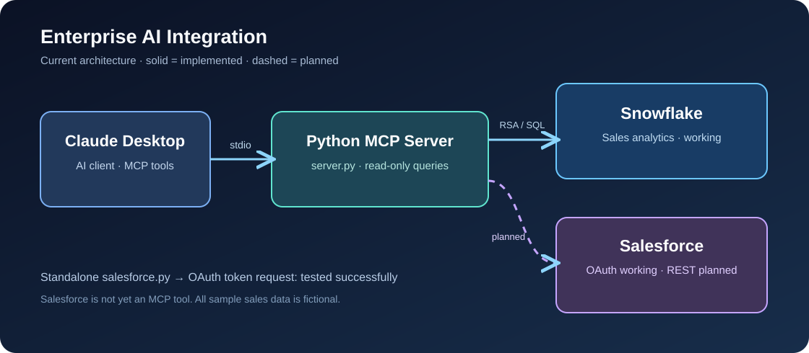

# Architecture and data flow

## Design goal

Allow an AI assistant to retrieve specific business metrics from enterprise systems without embedding database credentials in the assistant or granting unrestricted database access.

## Current working Snowflake path

1. Claude Desktop starts the local Python MCP server as a subprocess using the configured virtual-environment interpreter.
2. MCP communicates with the server over **standard input/output (stdio)**.
3. Claude selects one of two exposed tools: `get_sales_by_territory()` or `get_sales_by_representative()`.
4. `server.py` authenticates to Snowflake using the dedicated `AI_MCP_SERVICE` user and a locally stored RSA private key.
5. Snowflake executes a **fixed read-only SQL aggregation** against `ENTERPRISE_AI.SALES.SALES_TRANSACTIONS`.
6. Python converts returned rows into a list of dictionaries for the MCP client.

The current implementation opens and closes a Snowflake connection for each tool invocation. It does not accept arbitrary SQL from the assistant.

## Current working Salesforce path (authentication only)

1. `salesforce.py` loads `SALESFORCE_CLIENT_ID`, `SALESFORCE_CLIENT_SECRET`, and `SALESFORCE_INSTANCE_URL` from the local `.env` file.
2. Python sends a POST request with `grant_type=client_credentials` to `/services/oauth2/token`.
3. Salesforce validates the External Client App and its configured **Run As** integration user.
4. Python receives an access token and prints only a success message, **not the token**.

**Not yet implemented:** Salesforce SOQL requests, Account JSON retrieval, Salesforce MCP tools, and combined Snowflake/Salesforce analytics.

## Data model used for demonstration

- Snowflake: 10 fictional sales transactions; revenue grouped by territory and representative.
- Salesforce: fictional `Account` named **Pacific Tech Solutions**, Industry **Technology**; billing address configured via Salesforce UI.
- In the Salesforce permission interface, billing subfields appeared grouped under **Billing Address**. REST access to `BillingCity` and `BillingState` remains to be verified.

## Planned integration boundary

Add a Salesforce REST client with a restricted SOQL query, test object/field/record permissions, then wrap the query in an MCP tool. A later milestone will correlate CRM opportunity pipeline with Snowflake historical revenue. Do not claim that this combined flow is currently operational.
